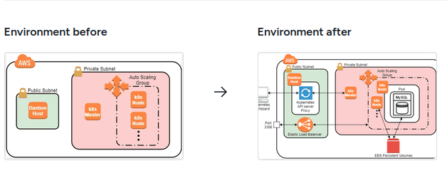

# Deploy a Stateful Application in a Kubernetes Cluster

## Overview

This hands-on lab demonstrates how Kubernetes runs a stateful application using a MySQL database deployed as a StatefulSet. You will inspect a multi-node Kubernetes cluster, configure stable network identity and persistent storage, deploy a replicated database, test replication and recovery behavior, expose a Service, and explore the Kubernetes Dashboard.

Unlike stateless replicas, stateful workloads often need stable identities and durable data. Kubernetes StatefulSets work with headless Services and PersistentVolumeClaims to provide ordered Pod identities and storage that can follow a Pod when it is recreated.

> **Compatibility note:** This lab follows the original training environment and uses legacy components, including MySQL 5.7 and the in-tree AWS EBS provisioner. MySQL 5.7 is in Oracle Sustaining Support, and Kubernetes removed the in-tree AWS EBS storage driver in Kubernetes v1.27. Use these manifests only on a compatible disposable training cluster. For a current cluster, follow the EBS CSI notes in the StorageClass section and use a supported MySQL version.

## Learning Objectives

After completing this lab, you should be able to:

- Inspect a multi-node Kubernetes cluster and its system components.
- Explain how StatefulSets differ from Deployments.
- Use a headless Service to provide stable Pod DNS identities.
- Configure a StorageClass and dynamically provision AWS EBS PersistentVolumes.
- Understand PersistentVolumes (PVs), PersistentVolumeClaims (PVCs), and volume claim templates.
- Deploy a replicated MySQL workload and verify data replication.
- Observe how Kubernetes reschedules Pods after eviction or deletion.
- Scale a StatefulSet and understand storage retention behavior.
- Understand how a Service of type LoadBalancer provisions an external AWS load balancer.
- Inspect workloads and storage through the Kubernetes Dashboard.
- Identify security and operational considerations when managing stateful applications.

## Architecture

Conceptually, the lab uses the following components:

~~~text
Browser / SSH Client
        |
        v
   Bastion Node
        |
        v
Kubernetes Control Plane -------- Worker Nodes
        |                               |
        |                         StatefulSet: mysql
        |                         mysql-0 (primary)
        |                         mysql-1 (replica)
        |                         mysql-2 (replica)
        |                               |
        |                         PVC per Pod
        |                               |
        |                         AWS EBS volumes
        |
        +---- Kubernetes Dashboard

Headless Service: mysql
  -> stable Pod DNS names (mysql-0.mysql, mysql-1.mysql, ...)

Read Service: mysql-read
  -> distributes reads to ready MySQL Pods
~~~

Exact behavior depends on the Kubernetes version, AWS cloud integration, installed EBS driver, and training environment.

## Technologies Used

| Technology | Purpose |
|---|---|
| Kubernetes | Orchestrates database Pods and cluster resources |
| kubectl | Creates, inspects, scales, and manages Kubernetes resources |
| StatefulSet | Manages stateful Pods with stable identities and ordered lifecycle |
| ConfigMap | Supplies MySQL configuration files |
| Headless Service | Provides predictable DNS names for individual StatefulSet Pods |
| ClusterIP Service | Provides an in-cluster endpoint for database reads |
| StorageClass | Defines how storage is dynamically provisioned |
| PersistentVolume (PV) | Represents provisioned persistent storage |
| PersistentVolumeClaim (PVC) | Requests storage for a Pod |
| Amazon EBS | Provides persistent block storage for the lab |
| MySQL replication | Replicates data from a primary to replicas |
| XtraBackup | Supports cloning database data for replica initialization |
| Kubernetes Dashboard | Provides a graphical view of workloads and storage |
| AWS Load Balancer | Exposes the read Service externally in the lab demonstration |

## Prerequisites

You should be familiar with:

- Basic Kubernetes concepts, including Pods, Services, labels, and namespaces.
- Linux command-line operations.
- SSH access and public/private key authentication.
- AWS EC2 and Amazon EBS concepts.
- Basic MySQL concepts.

You will need access to the training-provided Kubernetes cluster, bastion host, and credentials. The cluster in the original lab is initialized with kubeadm on Ubuntu and runs on AWS.

## Important Security Notes

- **Do not publish lab passwords, private keys, session tokens, or other credentials in this README or in Git history.** Use the credentials provided by your active training session.
- Do not commit a real bastion IP address if it identifies a temporary or private environment. Obtain the current connection command from the lab panel.
- MySQL in this exercise is configured with an empty root password to simplify the training task. This is unsafe for production.
- The example grants the Dashboard service account the cluster-admin role. That grants broad administrative privileges; use it only for a disposable lab, keep access private, and remove the binding after the exercise.
- Exposing a MySQL Service through an external LoadBalancer can make the database reachable outside the cluster. Do this only when explicitly required by the lab and protected by appropriate network controls. Prefer an internal Service or a temporary port-forward for normal administration.
- EBS volumes, load balancers, EC2 instances, and related resources can incur charges. Clean them up according to the lab provider's instructions.

---

## Step 1: Connect to the Kubernetes Cluster

### 1.1 Open the lab terminal

1. Navigate to the browser terminal supplied by the training platform.
2. At the login prompt, enter the lab-provided terminal username. In the original environment this was ca.
3. Follow the lab's instructions for the terminal password prompt.
4. Wait until the cloud environment has finished provisioning.

The original exercise provides a preconfigured cluster and a bastion node. The bastion acts as the access point to cluster resources in the private network.

### 1.2 Connect to the bastion

1. Open the training platform's Cloud Environment or Credentials panel.
2. Copy the current Cluster SSH command shown for your session.
3. Run that command in the browser terminal.

The command will resemble the example below. Use the host and key information from your own lab rather than the example address:

~~~bash
ssh ubuntu@<bastion-public-ip>
~~~

If the lab provides a key file, specify it with the appropriate SSH option:

~~~bash
ssh -i <path-to-private-key> ubuntu@<bastion-public-ip>
~~~

Use the actual user and SSH options displayed by the platform. Avoid disabling host-key verification as a general practice; only follow platform-specific host-key instructions in a temporary environment where the host identity is otherwise established.

### 1.3 Wait for the cluster nodes

From the bastion shell, monitor the cluster nodes:

~~~bash
watch kubectl get nodes
~~~

Press Ctrl+C to stop watching once the expected nodes are ready.

The worker node may take a few minutes to join. Do not deploy the application until at least one worker node is Ready.

A temporary message such as the API server connection being refused can occur while the control plane is still starting. If it persists, check the lab provisioning status and node health rather than assuming the cluster is ready.

---

## Step 2: Inspect the Kubernetes Cluster

### 2.1 List nodes

~~~bash
kubectl get nodes
kubectl get nodes -o wide
~~~

Confirm that the control-plane node and at least one worker node are listed and reach Ready status. The wider output includes internal IPs and node placement.

### 2.2 Describe the control-plane node

~~~bash
kubectl describe nodes -l node-role.kubernetes.io/control-plane | more
~~~

The more command displays output one page at a time. Press the space bar to advance.

Inspect the Taints section. A taint such as node-role.kubernetes.io/control-plane:NoSchedule keeps ordinary workloads from being scheduled on the control-plane node unless a Pod has a matching toleration. This helps reserve the control plane for Kubernetes components.

### 2.3 List namespaces

~~~bash
kubectl get namespaces
~~~

Common namespaces include default, kube-system, and kubernetes-dashboard. Exact namespaces vary by cluster setup.

### 2.4 Inspect system Pods

~~~bash
kubectl get pods -n kube-system -o wide
~~~

Common components may include:

| Component | Purpose |
|---|---|
| AWS cloud controller | Integrates Kubernetes with AWS resources where configured |
| Calico | Provides Pod networking and may enforce network policies |
| CoreDNS | Provides cluster DNS resolution |
| etcd | Stores Kubernetes API state |
| kube-apiserver | Exposes the Kubernetes API |
| kube-controller-manager | Runs control loops that reconcile cluster state |
| kube-proxy | Supports Service networking, depending on cluster configuration |
| kube-scheduler | Assigns unscheduled Pods to nodes |
| metrics-server | Provides resource metrics used by kubectl top and some dashboards |
| EBS CSI components or legacy AWS EBS provisioner | Supports lifecycle operations for persistent EBS-backed volumes |

Component names and deployment types depend on the Kubernetes version and installed add-ons.

Verify the cluster before moving on:

~~~bash
kubectl get nodes
kubectl get pods -n kube-system
kubectl get storageclass
~~~

## Step 3: Deploy MySQL as a StatefulSet

This section creates a ConfigMap, two Services, a StorageClass, and a StatefulSet. The training manifest deploys three MySQL Pods.

### 3.1 Create the MySQL ConfigMap

The ConfigMap stores MySQL configuration outside the container image: the primary enables binary logging and replicas use super-read-only mode.

~~~bash
cat <<'EOF' > mysql-configmap.yaml
apiVersion: v1
kind: ConfigMap
metadata:
  name: mysql
  labels:
    app: mysql
data:
  master.cnf: |
    # Primary configuration
    [mysqld]
    log-bin
  slave.cnf: |
    # Replica configuration
    [mysqld]
    super-read-only
EOF

kubectl apply -f mysql-configmap.yaml
kubectl get configmap mysql
kubectl describe configmap mysql
~~~

### 3.2 Create the Services

The headless Service named mysql provides stable DNS names for StatefulSet Pods. The mysql-read ClusterIP Service provides an in-cluster endpoint for read connections.

~~~bash
cat <<'EOF' > mysql-services.yaml
apiVersion: v1
kind: Service
metadata:
  name: mysql
  labels:
    app: mysql
spec:
  ports:
  - name: mysql
    port: 3306
  clusterIP: None
  selector:
    app: mysql
---
apiVersion: v1
kind: Service
metadata:
  name: mysql-read
  labels:
    app: mysql
spec:
  ports:
  - name: mysql
    port: 3306
  selector:
    app: mysql
EOF

kubectl apply -f mysql-services.yaml
kubectl get services mysql mysql-read
kubectl describe service mysql
kubectl describe service mysql-read
~~~

The first StatefulSet Pod is mysql-0. Its stable DNS name is mysql-0.mysql in the same namespace. A Service distributes connections to its ready endpoints; it does not make all queries safe for replicas or guarantee strong consistency.

### 3.3 Create a StorageClass for the legacy training cluster

The original training cluster uses the in-tree AWS EBS provisioner. This manifest is for an older compatible Kubernetes environment:

~~~bash
cat <<'EOF' > mysql-storageclass.yaml
apiVersion: storage.k8s.io/v1
kind: StorageClass
metadata:
  name: general
provisioner: kubernetes.io/aws-ebs
parameters:
  type: gp2
EOF

kubectl apply -f mysql-storageclass.yaml
kubectl get storageclass
kubectl describe storageclass general
~~~

This StorageClass requests gp2 EBS volumes when the StatefulSet creates PVCs. EBS volumes are zonal; the cluster's AWS integration manages provisioning and attachment.

**For modern clusters:** The in-tree AWS EBS provisioner was removed in Kubernetes v1.27. A current cluster generally requires the AWS EBS CSI driver. If the driver is installed and configured, use an appropriate StorageClass such as the following instead of the legacy manifest. Do not apply both definitions with the same name.

~~~yaml
apiVersion: storage.k8s.io/v1
kind: StorageClass
metadata:
  name: general
provisioner: ebs.csi.aws.com
volumeBindingMode: WaitForFirstConsumer
parameters:
  type: gp3
  csi.storage.k8s.io/fstype: ext4
  encrypted: "true"
~~~

Save the appropriate definition as mysql-storageclass.yaml for the target cluster. Before changing a storage provisioner on an existing cluster, check the Kubernetes version, installed driver, AWS permissions, and volume migration requirements.

### 3.4 Create the MySQL StatefulSet manifest

The following is the training lab design. It includes two init containers, the MySQL server, an XtraBackup sidecar, temporary configuration volumes, and a persistent volume claim template.

**Lab-only limitations:** This example uses MySQL 5.7 images and an empty root password. It is not production-ready. For a real environment use a supported database image, Secrets or an external secret manager, resource limits, network policies, backups, and a reviewed replication design.

~~~bash
cat <<'EOF' > mysql-statefulset.yaml
apiVersion: apps/v1
kind: StatefulSet
metadata:
  name: mysql
spec:
  selector:
    matchLabels:
      app: mysql
  serviceName: mysql
  replicas: 3
  template:
    metadata:
      labels:
        app: mysql
    spec:
      initContainers:
      - name: init-mysql
        image: mysql:5.7.35
        command:
        - bash
        - "-c"
        - |
          set -ex
          [[ $(hostname) =~ -([0-9]+)$ ]] || exit 1
          ordinal=REMATCH_ONE
          echo [mysqld] > /mnt/conf.d/server-id.cnf
          echo server-id=$((100 + $ordinal)) >> /mnt/conf.d/server-id.cnf
          if [[ $ordinal -eq 0 ]]; then
            cp /mnt/config-map/master.cnf /mnt/conf.d/
          else
            cp /mnt/config-map/slave.cnf /mnt/conf.d/
          fi
        volumeMounts:
        - name: conf
          mountPath: /mnt/conf.d
        - name: config-map
          mountPath: /mnt/config-map
      - name: clone-mysql
        image: gcr.io/google-samples/xtrabackup:1.0
        command:
        - bash
        - "-c"
        - |
          set -ex
          [[ -d /var/lib/mysql/mysql ]] && exit 0
          [[ $(hostname) =~ -([0-9]+)$ ]] || exit 1
          ordinal=REMATCH_ONE
          [[ $ordinal -eq 0 ]] && exit 0
          ncat --recv-only mysql-$(($ordinal-1)).mysql 3307 | xbstream -x -C /var/lib/mysql
          xtrabackup --prepare --target-dir=/var/lib/mysql
        volumeMounts:
        - name: data
          mountPath: /var/lib/mysql
          subPath: mysql
        - name: conf
          mountPath: /etc/mysql/conf.d
      containers:
      - name: mysql
        image: mysql:5.7
        env:
        - name: MYSQL_ALLOW_EMPTY_PASSWORD
          value: "1"
        ports:
        - name: mysql
          containerPort: 3306
        volumeMounts:
        - name: data
          mountPath: /var/lib/mysql
          subPath: mysql
        - name: conf
          mountPath: /etc/mysql/conf.d
        resources:
          requests:
            cpu: 100m
            memory: 200Mi
        livenessProbe:
          exec:
            command: ["mysqladmin", "ping"]
          initialDelaySeconds: 30
          timeoutSeconds: 5
        readinessProbe:
          exec:
            command: ["mysql", "-h", "127.0.0.1", "-e", "SELECT 1"]
          initialDelaySeconds: 5
          timeoutSeconds: 1
      - name: xtrabackup
        image: gcr.io/google-samples/xtrabackup:1.0
        ports:
        - name: xtrabackup
          containerPort: 3307
        command:
        - bash
        - "-c"
        - |
          set -ex
          cd /var/lib/mysql
          if [[ -f xtrabackup_slave_info ]]; then
            mv xtrabackup_slave_info change_master_to.sql.in
            rm -f xtrabackup_binlog_info
          elif [[ -f xtrabackup_binlog_info ]]; then
            [[ $(cat xtrabackup_binlog_info) =~ ^(.*?)[[:space:]]+(.*?)$ ]] || exit 1
            rm xtrabackup_binlog_info
            echo "CHANGE MASTER TO MASTER_LOG_FILE='REMATCH_ONE',\
                  MASTER_LOG_POS=REMATCH_TWO" > change_master_to.sql.in
          fi
          if [[ -f change_master_to.sql.in ]]; then
            echo "Waiting for mysqld to accept connections"
            until mysql -h 127.0.0.1 -e "SELECT 1"; do sleep 1; done
            echo "Initializing replication from clone position"
            mv change_master_to.sql.in change_master_to.sql.orig
            mysql -h 127.0.0.1 <<EOFSQL
          $(cat change_master_to.sql.orig),
            MASTER_HOST='mysql-0.mysql',
            MASTER_USER='root',
            MASTER_PASSWORD='',
            MASTER_CONNECT_RETRY=10;
          START SLAVE;
          EOFSQL
          fi
          exec ncat --listen --keep-open --send-only --max-conns=1 3307 -c \
            "xtrabackup --backup --slave-info --stream=xbstream --host=127.0.0.1 --user=root"
        volumeMounts:
        - name: data
          mountPath: /var/lib/mysql
          subPath: mysql
        - name: conf
          mountPath: /etc/mysql/conf.d
        resources:
          requests:
            cpu: 100m
            memory: 50Mi
      volumes:
      - name: conf
        emptyDir: {}
      - name: config-map
        configMap:
          name: mysql
  volumeClaimTemplates:
  - metadata:
      name: data
    spec:
      accessModes: ["ReadWriteOnce"]
      resources:
        requests:
          storage: 2Gi
      storageClassName: general
EOF

python3 - <<'PY'
from pathlib import Path
p = Path("mysql-statefulset.yaml")
content = p.read_text()
content = content.replace("REMATCH_ONE", chr(36) + "{BASH_REMATCH[1]}")
content = content.replace("REMATCH_TWO", chr(36) + "{BASH_REMATCH[2]}")
p.write_text(content)
PY

grep -n 'CHANGE MASTER TO' -A1 mysql-statefulset.yaml
kubectl apply --dry-run=client -f mysql-statefulset.yaml
~~~

The Python snippet inserts the Bash variable expressions into the YAML without requiring shell escaping in the README. Inspect the output after substitution. A client-side dry run checks object structure; it does not prove the images, storage provisioning, or replication work at runtime.

### 3.5 Understand the StatefulSet components

- **init-mysql:** Generates a unique MySQL server ID from the Pod ordinal and copies primary or replica configuration from the ConfigMap.
- **clone-mysql:** Skips the primary and clones database files from the preceding Pod when a replica needs initialization.
- **mysql:** Runs the database server and mounts configuration and persistent data.
- **xtrabackup:** Provides backup streaming and helps initialize replication on replicas.
- **conf (emptyDir):** Holds generated configuration and can be recreated with the Pod.
- **config-map:** Provides the ConfigMap files to the init container.
- **data (volumeClaimTemplates):** Requests a separate PVC for each StatefulSet Pod.

The ReadWriteOnce access mode generally allows a volume to be mounted read/write by one node at a time. It is not a shared multi-node filesystem.

### 3.6 Create the StatefulSet and watch Pod startup

~~~bash
kubectl apply -f mysql-statefulset.yaml
kubectl get pods -l app=mysql --watch
~~~

The watch option streams changes as Kubernetes creates and initializes the Pods. It may take several minutes for all containers and replicas to become ready. Press Ctrl+C after inspecting the results.

Check the Pods and storage:

~~~bash
kubectl get statefulset mysql
kubectl get pods -l app=mysql -o wide
kubectl get pvc
kubectl get pv
~~~

In the AWS console, open EC2 → Elastic Block Store → Volumes. As PVCs bind and volumes are provisioned, inspect the EBS volume tags and sizes. Each Pod requests a 2 GiB volume in the lab manifest.

Describe the storage resources:

~~~bash
kubectl describe pv
kubectl describe pvc
kubectl get statefulset mysql
~~~

**Expected result:** Three ordered Pods named mysql-0, mysql-1, and mysql-2, each with a PVC created from the volume claim template. The exact status depends on successful image pulls, node capacity, storage provisioning, and replication initialization.

## Step 4: Work with the Stateful Application

This step checks database connectivity, confirms that reads can reach different MySQL Pods, simulates node maintenance, scales the StatefulSet, and demonstrates Service exposure.

### 4.1 Create test data on the primary

Use a temporary MySQL client Pod to connect to the primary through its stable DNS name:

~~~bash
kubectl run mysql-client \
  --image=mysql:5.7 \
  -i -t --rm --restart=Never -- \
  /usr/bin/mysql -h mysql-0.mysql \
  -e "CREATE DATABASE mydb; CREATE TABLE mydb.notes (note VARCHAR(250)); INSERT INTO mydb.notes VALUES ('Kubernetes StatefulSet lab');"
~~~

This creates a database named mydb, a notes table, and one record. The example assumes the training containers use the empty root password configuration described earlier.

If the client cannot connect, inspect the StatefulSet Pods, Services, endpoints, readiness, and logs.

### 4.2 Query the read Service

~~~bash
kubectl run mysql-client \
  --image=mysql:5.7 \
  -i -t --rm --restart=Never -- \
  /usr/bin/mysql -h mysql-read \
  -e "SELECT * FROM mydb.notes"
~~~

The mysql-read Service selects ready Pods labeled app=mysql. Because replication is asynchronous, a recently written row may not be visible immediately on every replica.

### 4.3 Observe which MySQL server answers reads

~~~bash
kubectl run mysql-client-loop \
  --image=mysql:5.7 \
  -i -t --rm --restart=Never -- \
  bash -ic "while sleep 1; do /usr/bin/mysql -h mysql-read -e 'SELECT @@server_id'; done"
~~~

The loop queries the server ID once per second through mysql-read. The primary's ID is 100 and replicas have IDs derived from their StatefulSet ordinals.

Press Ctrl+C to stop. Depending on endpoints and replica readiness, you may not observe every ID immediately.

### 4.4 Inspect Pod placement

~~~bash
kubectl get pods -l app=mysql -o wide
~~~

The output shows the node hosting each Pod. Actual placement depends on worker capacity, Pod constraints, storage availability zones, and scheduler decisions; Kubernetes does not guarantee an even distribution without suitable topology constraints.

### 4.5 Drain the node running mysql-2

Draining simulates taking a node out of service for maintenance. Run this only in the lab cluster because the command can interrupt other workloads on that node.

~~~bash
node=$(kubectl get pod mysql-2 -o jsonpath='{.spec.nodeName}')
echo "$node"
kubectl drain "$node" --force --delete-emptydir-data --ignore-daemonsets
~~~

Explanation:

- The first command finds the node currently hosting mysql-2.
- kubectl drain marks the node unschedulable and evicts eligible Pods.
- --ignore-daemonsets skips DaemonSet-managed Pods.
- --delete-emptydir-data allows eviction of Pods that use emptyDir volumes, whose temporary contents will be lost.
- --force allows drain to proceed with certain unmanaged Pods; do not use it casually on production nodes.

Check that the PVC and PV remain bound and that the Pod can reattach its volume on an eligible node.

### 4.6 Observe rescheduling and uncordon the node

~~~bash
kubectl get pods -l app=mysql -o wide --watch
~~~

Wait for the affected Pod to be recreated and become ready, then press Ctrl+C.

Allow scheduling on the node again:

~~~bash
kubectl uncordon "$node"
kubectl get nodes
~~~

If the Pod remains pending, inspect events, PVC/PV status, the EBS volume's availability zone, and EBS driver logs.

### 4.7 Delete a Pod to observe StatefulSet recovery

~~~bash
kubectl delete pod mysql-2
kubectl get pod mysql-2 -o wide --watch
~~~

Press Ctrl+C after observing the replacement. The StatefulSet controller attempts to maintain its desired replica count and recreate the missing Pod with the same ordinal and stable identity.

Deleting a Pod does not automatically delete the PVC created from its volume claim template. This illustrates the difference between Pod lifecycle and persistent storage lifecycle.

### 4.8 Scale the StatefulSet to five replicas

~~~bash
kubectl scale statefulset mysql --replicas=5
kubectl get pods -l app=mysql --watch
~~~

Wait for mysql-3 and mysql-4 to initialize, then press Ctrl+C. Check the replicas and storage:

~~~bash
kubectl get statefulset mysql
kubectl get pods -l app=mysql -o wide
kubectl get pvc
~~~

Each new ordinal should receive a PVC from the claim template. The new replicas must initialize and start replicating before they become ready.

### 4.9 Verify server IDs and replicated data

Run the server ID loop again:

~~~bash
kubectl run mysql-client-loop \
  --image=mysql:5.7 \
  -i -t --rm --restart=Never -- \
  bash -ic "while sleep 1; do /usr/bin/mysql -h mysql-read -e 'SELECT @@server_id'; done"
~~~

Press Ctrl+C after observing the results.

Query the notes table through mysql-4 directly:

~~~bash
kubectl run mysql-client \
  --image=mysql:5.7 \
  -i -t --rm --restart=Never -- \
  /usr/bin/mysql -h mysql-4.mysql \
  -e "SELECT * FROM mydb.notes"
~~~

If the table or row is not present yet, inspect replica initialization and replication status. The replication model in this lab is asynchronous, so replicas may lag behind the primary.

### 4.10 Inspect the mysql-read Service

~~~bash
kubectl get service mysql-read
kubectl describe service mysql-read
~~~

The Service is initially type ClusterIP and is reachable from inside the cluster.

### 4.11 Optional: Expose the read Service through an AWS LoadBalancer

**Security warning:** This exposes the MySQL read endpoint through a load balancer. Do this only if explicitly required by the lab, only in a disposable environment, and with appropriate network restrictions. Do not expose an unauthenticated database to the public internet.

The original lab changes mysql-read to type LoadBalancer. Patch the Service rather than appending lines to the YAML file:

~~~bash
kubectl patch service mysql-read --type merge \
  -p '{"spec":{"type":"LoadBalancer"}}'
kubectl get service mysql-read --watch
~~~

When provisioning completes, inspect the Service:

~~~bash
kubectl describe service mysql-read
kubectl get service mysql-read -o wide
~~~

Retrieve the external hostname:

~~~bash
kubectl get service mysql-read -o jsonpath='{.status.loadBalancer.ingress[0].hostname}'
echo
~~~

Provisioning and behavior depend on the cluster's AWS integration. If the hostname remains empty, inspect Service events and the cloud-controller/load-balancer integration.

For a safer lab, use an internal load balancer if supported and access is needed only from the VPC. If external access is used, ensure network restrictions are in place.

### 4.12 Test the load balancer (only if intentionally exposed)

Set the hostname returned by the previous command:

~~~bash
load_balancer="<load-balancer-hostname>"
~~~

Then connect with a temporary client Pod:

~~~bash
kubectl run mysql-client-loop \
  --image=mysql:5.7 \
  -i -t --rm --restart=Never -- \
  bash -ic "while sleep 1; do /usr/bin/mysql -h $load_balancer -e 'SELECT @@server_id'; done"
~~~

If the load balancer was just created, it may take time for targets to register and become healthy. Press Ctrl+C to stop the loop when you have collected enough observations.

### Step 4 Summary

This step demonstrated direct access to the primary using stable DNS, reads through a Service, node draining, Pod recovery, scaling from three to five replicas, persistent volume claim behavior, and optional load balancer provisioning.

## Step 5: Monitor the Cluster with Kubernetes Dashboard

The training cluster includes Kubernetes Dashboard resources in the kubernetes-dashboard namespace. Dashboard provides a graphical view of resources such as Pods, StatefulSets, Services, and PersistentVolumes.

### 5.1 Create a Dashboard service account for the lab

**Security warning:** The original training exercise binds the cluster-admin role, which grants broad privileges across the cluster. Use this only in the disposable lab. For real environments, use the least-privilege role needed for the task and a supported authentication approach.

Create the service account and binding manifest:

~~~bash
cat <<'EOF' > dashboard-admin.yaml
apiVersion: v1
kind: ServiceAccount
metadata:
  name: dashboard-admin
  namespace: kubernetes-dashboard
---
apiVersion: rbac.authorization.k8s.io/v1
kind: ClusterRoleBinding
metadata:
  name: dashboard-admin
roleRef:
  apiGroup: rbac.authorization.k8s.io
  kind: ClusterRole
  name: cluster-admin
subjects:
- kind: ServiceAccount
  name: dashboard-admin
  namespace: kubernetes-dashboard
EOF
~~~

Apply the resources:

~~~bash
kubectl apply -f dashboard-admin.yaml
kubectl get serviceaccount dashboard-admin -n kubernetes-dashboard
kubectl get clusterrolebinding dashboard-admin
~~~

### 5.2 Generate a login token

~~~bash
kubectl -n kubernetes-dashboard create token dashboard-admin
~~~

Copy the token into a secure temporary note for this lab session only. Treat it as an administrator credential. Do not add it to the README, commit it to Git, or reuse it outside this training environment.

### 5.3 Forward the Dashboard port

The Dashboard Service usually serves HTTPS on port 443. A safer default is to bind the forward to the bastion's loopback interface:

~~~bash
kubectl port-forward -n kubernetes-dashboard --address 127.0.0.1 service/kubernetes-dashboard 8001:443
~~~

Keep this command running. If you access the bastion from your own computer, create an SSH tunnel from your computer to the bastion in a separate local terminal:

~~~bash
ssh -L 8001:127.0.0.1:8001 ubuntu@<bastion-public-ip>
~~~

Then open the Dashboard URL through the local tunnel at https://localhost:8001, assuming the SSH connection and port-forward are active. Use the bastion host and authentication options provided by the lab platform.

**Training-platform alternative:** Some hosted labs expect the port-forward to listen on the bastion's network interfaces and then ask you to open the Dashboard using the bastion address. If the lab requires this workflow, use it only in the disposable environment and restrict inbound port 8001 in the bastion security group to your own client IP. Do not expose the port to all addresses.

~~~bash
kubectl port-forward -n kubernetes-dashboard --address 0.0.0.0 service/kubernetes-dashboard 8001:443
~~~

A browser warning may appear when the lab uses a self-signed TLS certificate. Do not ignore certificate warnings on production or other untrusted systems. For the isolated lab, follow the training provider's documented way to access the temporary Dashboard endpoint.

### 5.4 Sign in to Dashboard

1. Open the Dashboard endpoint through the port-forward or SSH tunnel.
2. Select token-based authentication if the UI asks for an authentication method.
3. Paste the token generated in Step 5.2.
4. Sign in and inspect the workloads.

Do not paste the token into the README, a screenshot, a shared terminal transcript, or another public location.

### 5.5 Inspect StatefulSets and scale down

1. In the Dashboard, navigate to Workloads and then Stateful Sets.
2. Open the mysql StatefulSet.
3. Review Pod status, CPU and memory metrics if metrics-server is available, and the number of replicas.
4. Use Scale to change desired replicas from five back to three.
5. Confirm that mysql-4 and then mysql-3 are removed in reverse ordinal order.

You can do the same operation with kubectl:

~~~bash
kubectl scale statefulset mysql --replicas=3
kubectl get pods -l app=mysql --watch
~~~

Press Ctrl+C after you have observed the scale-down.

### 5.6 Inspect PersistentVolumes after scale-down

Navigate in Dashboard to Cluster → Persistent Volumes. The lab may show PVs that remain after scaling down. StatefulSet PVC retention and the StorageClass reclaim policy affect what happens to claims and backing volumes. A Pod being removed does not imply that its storage is immediately deleted.

Inspect the storage state from the shell:

~~~bash
kubectl get pvc
kubectl get pv
kubectl describe pvc data-mysql-4
~~~

If the lab asks you to remove the unused storage for mysql-4, first verify that the claim is no longer needed and identify its bound PV. Deleting a PVC can cause data loss and, depending on the PV reclaim policy, may delete the backing EBS volume.

In the Dashboard, the original exercise attempts to delete the PV before its claim; Kubernetes will not normally delete a PV while it is still bound to a PVC. To remove the unused claim and test the lifecycle:

~~~bash
kubectl delete pvc data-mysql-4
kubectl get pvc
kubectl get pv
~~~

Only perform this deletion for the disposable lab after confirming the data is no longer needed. If the reclaim policy is Retain, the EBS-backed PV may remain and require a separate, deliberate cleanup procedure. If the policy is Delete, deleting the claim may also delete the backing volume.

### 5.7 Remove temporary Dashboard privileges

After finishing the Dashboard exercise, remove the broad role binding and the service account created for this lab:

~~~bash
kubectl delete clusterrolebinding dashboard-admin
kubectl delete serviceaccount dashboard-admin -n kubernetes-dashboard
~~~

Stop the port-forward with Ctrl+C in the terminal where it is running. If you opened port 8001 in a security group for this lab, remove that inbound rule.

### Step 5 Summary

You used Kubernetes Dashboard to inspect workloads and storage, scale a StatefulSet, and review PersistentVolumes. You also saw why Dashboard authentication, RBAC, network exposure, and storage cleanup require care.

---

## Troubleshooting

| Symptom | Possible cause | Checks |
|---|---|---|
| kubectl cannot connect to the API server | Cluster is still provisioning, kubeconfig is wrong, or API server is unavailable | Check lab readiness, current context, node status, and control-plane logs |
| Worker node is NotReady | Node provisioning, CNI, kubelet, or resource issue | kubectl describe node <node-name>; inspect system Pods |
| Pod is Pending | PVC unbound, storage capacity/zone mismatch, insufficient CPU or memory | kubectl describe pod <pod-name>; kubectl get pvc; check Events |
| Pod is stuck in Init | Image pull failure, ConfigMap missing, data clone failure, or previous peer unavailable | kubectl describe pod <pod-name>; inspect init container logs |
| Pod is CrashLoopBackOff | MySQL configuration issue, failed probe, missing storage, or incompatible image | kubectl logs <pod-name> -c mysql; kubectl describe pod <pod-name> |
| PVC is Pending | StorageClass provisioner unavailable, AWS permissions absent, or CSI driver missing | kubectl describe pvc <claim-name>; kubectl get storageclass; inspect EBS CSI Pods |
| MySQL read query fails | Service endpoints not ready, DNS failure, replica not initialized, or authentication mismatch | kubectl get endpoints mysql-read; test mysql-0.mysql; inspect container logs |
| New replica lacks data | Clone or asynchronous replication not complete or failed | Inspect xtrabackup and mysql container logs and replication status |
| Node drain is blocked | PodDisruptionBudget, unmanaged Pod, or other eviction restriction | Read the drain error and inspect the affected Pod's owner and disruption policy |
| LoadBalancer hostname is empty | Provisioning is pending or AWS integration lacks permissions/support | kubectl describe service mysql-read; inspect events and cloud-controller logs |
| Dashboard is unreachable | Port-forward stopped, wrong port/tunnel, or network rule missing | Check port-forward output, SSH tunnel, security group, and service endpoints |
| Dashboard access is denied | Token is invalid/expired or RBAC is missing | Generate a new short-lived token and review the Dashboard role binding |

Useful diagnostic commands:

~~~bash
kubectl get nodes -o wide
kubectl get pods -A -o wide
kubectl get events --sort-by=.lastTimestamp
kubectl get statefulset mysql
kubectl get services,endpoints
kubectl get pvc,pv
kubectl describe pod mysql-0
kubectl logs mysql-0 -c mysql
kubectl logs mysql-1 -c xtrabackup
~~~

Replace example Pod and claim names with the actual resource names. A command that shows no endpoints or no events can itself help narrow down the problem.

---

## Security and Operational Considerations

- Use a supported MySQL version, non-empty credentials, and Kubernetes Secrets or an external secret manager for actual workloads.
- Use least-privilege RBAC. Do not leave a cluster-admin binding on the Dashboard account after the lab.
- Keep the Dashboard behind private access controls. Avoid binding administrative port-forwards to all network interfaces unless the training platform explicitly requires it and network access is restricted.
- Avoid exposing database ports to the public internet. Prefer ClusterIP or a deliberately configured internal load balancer for private database traffic.
- Use the AWS EBS CSI driver on modern Kubernetes clusters; the legacy in-tree provisioner in the training manifest is not supported on Kubernetes v1.27 and later.
- Validate storage availability zones and topology before rescheduling Pods that use EBS volumes.
- Configure backups and test restore procedures. A PersistentVolume alone is not a database backup.
- Add resource requests and limits, readiness/liveness probes suited to the application, Pod disruption policies, monitoring, and tested recovery procedures for production.
- Review storage and load balancer costs, and remove test resources after the lab.

## Cleanup

Follow the training provider's cleanup instructions first, especially if the environment is managed for you.

For the standalone resources created by this exercise, remove the Dashboard access created above and any optional load-balancer exposure:

~~~bash
kubectl delete clusterrolebinding dashboard-admin --ignore-not-found
kubectl delete serviceaccount dashboard-admin -n kubernetes-dashboard --ignore-not-found
kubectl patch service mysql-read --type merge -p '{"spec":{"type":"ClusterIP"}}'
~~~

If the lab is ending and the database workload is no longer needed, inspect the StatefulSet and its PVCs before deleting anything:

~~~bash
kubectl get statefulset mysql
kubectl get pvc
kubectl get pv
~~~

Only delete the StatefulSet and storage after confirming that no data must be retained. Deleting PVCs or PVs can permanently delete the database files or backing EBS volumes:

~~~bash
kubectl delete statefulset mysql
kubectl delete service mysql mysql-read
kubectl delete configmap mysql
kubectl delete storageclass general
~~~

PVCs from a StatefulSet may remain after the StatefulSet is deleted. Check and delete claims deliberately only when their data is no longer required:

~~~bash
kubectl get pvc
# Delete only the lab PVCs after confirming their data is disposable:
# kubectl delete pvc data-mysql-0 data-mysql-1 data-mysql-2
~~~

If the lab created AWS load balancers and EBS volumes, verify that they are removed according to the service and PV reclaim policies. A StorageClass with a Retain reclaim policy can leave EBS volumes behind. Check the AWS console and billing tools after cleanup.

## Key Takeaways

This lab demonstrates that a stateful Kubernetes workload involves more than keeping Pods running:

- StatefulSets provide stable Pod identities and ordered lifecycle behavior.
- Headless Services provide DNS identities for individual StatefulSet Pods.
- PVCs and PVs separate persistent data lifecycle from Pod lifecycle.
- StorageClass and the appropriate storage driver provide dynamic storage provisioning.
- Asynchronous replication can improve read capacity but introduces replication lag.
- Kubernetes can recreate Pods after deletion or eviction, but storage topology still matters.
- Services and AWS load balancers influence how database endpoints are reached.
- Dashboard access, RBAC, credentials, external exposure, and cleanup must be handled carefully.

## References

- [Kubernetes StatefulSets](https://kubernetes.io/docs/concepts/workloads/controllers/statefulset/)
- [Kubernetes Services](https://kubernetes.io/docs/concepts/services-networking/service/)
- [Persistent Volumes and Claims](https://kubernetes.io/docs/concepts/storage/persistent-volumes/)
- [Storage Classes](https://kubernetes.io/docs/concepts/storage/storage-classes/)
- [AWS EBS CSI Driver](https://github.com/kubernetes-sigs/aws-ebs-csi-driver)
- [Kubernetes Dashboard](https://kubernetes.io/docs/tasks/access-application-cluster/web-ui-dashboard/)
- [MySQL Documentation](https://dev.mysql.com/doc/)
- [Kubernetes kubectl reference](https://kubernetes.io/docs/reference/kubectl/)

## Disclaimer

This README documents a hands-on training exercise. The sample MySQL version, replication approach, AWS EBS provisioner, and Dashboard permissions reflect a legacy lab environment. Validate all manifests and commands for your Kubernetes version before using them. Never use the lab's empty-password configuration or cluster-admin Dashboard binding in production.
